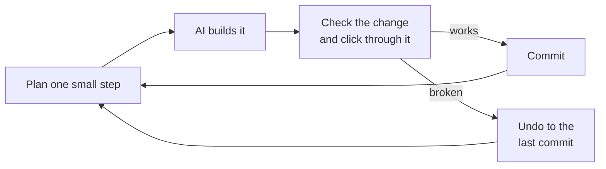

# Vibe coding well: working with AI tools

Most of this guide is about what your app needs. This chapter is about *how
you work*. The same AI tool can produce a solid app or a pile of fragile code,
and the difference is mostly the process around it: what you decide before
prompting, how big each step is, what the AI can see, and how you check its
work.

Labels as elsewhere: 🔴 **Now** means start doing this today, 🟡 **Soon** means
once your project is more than a weekend experiment, and ⚪ **Later** means
when the project or team grows.

## Contents

1. [Before you prompt](#1-before-you-prompt)
2. [Building in small steps](#2-building-in-small-steps)
3. [What your AI can and can't see](#3-what-your-ai-can-and-cant-see)
4. [Checking the AI's work without reading every line](#4-checking-the-ais-work-without-reading-every-line)
5. [Keeping the project easy for AI to work on](#5-keeping-the-project-easy-for-ai-to-work-on)
6. [Choosing your tools](#6-choosing-your-tools)
7. [Learning while you build](#7-learning-while-you-build)
8. [Copy-paste prompts for working well](#8-copy-paste-prompts-for-working-well)

---

## 1. Before you prompt

### Write a one-page spec — 🔴 Now

**What it is:** A short description of what you're building, written before
any code: who it's for, the main thing a user does, what data it stores, and
what's deliberately *not* included yet.

**Picture it:** You wouldn't tell a builder "make me a nice house" and walk
away. You'd say how many rooms, which floor, and what budget.

**What it means for you:** AI fills every gap with its own guesses, and it
guesses differently each time. A spec keeps the AI consistent across days and
conversations. Save it in the repo (for example `SPEC.md`) and point the AI at
it. A useful spec answers:

- **Who** uses it, and what are the 1–3 things they come to do?
- **The main flow,** step by step: "sign up → create a project → invite a
  teammate → ...".
- **The data:** what things exist (users, projects, invoices) and how they
  relate. See [Your database, explained](07-your-database.md).
- **Who can see what:** which data is private, shared with a team, or public.
- **Money:** free, paid, what's limited on which plan.
- **Not now:** the features you're deliberately leaving out.

### Ask for a plan before code — 🔴 Now

Before any substantial change, ask the AI to **describe its plan first**: which
files it will create or change, what the data will look like, and what could go
wrong. Read the plan, question it, then let it build. A wrong plan costs one
message to fix; wrong code costs an afternoon. Many tools have a dedicated
"plan" mode for this.

### Use boring, popular technology — 🟡 Soon

AI tools have seen enormous amounts of code for popular, established tools
(React, Next.js, Postgres, Supabase, Stripe, Tailwind) and much less for niche
or brand-new ones. With popular tools, the AI makes fewer mistakes, and you'll
find more answers online when it does. Pick a well-known stack, stick to it,
and avoid switching libraries halfway through because a new chat suggested a
different one.

---

## 2. Building in small steps

### One feature at a time — 🔴 Now

**What it is:** Asking for one small, testable change per request (for example
"add a sign-up form that saves to the users table"), not "build the whole app".

**Why:** Big requests produce big, tangled changes that are hard to check and
hard to undo. When something breaks, you can't tell which part did it. Small
steps keep each change understandable and each mistake cheap.

**Do:** After each step, run the app and click through it yourself. Then
commit. Then take the next step.



*The loop: one small step, check it, commit. When a step goes wrong, you lose
minutes, not days.*

### Commit as a checkpoint — 🔴 Now

Commit every time something works, before you ask for the next change. If the
AI breaks something, you go back to the last checkpoint instead of asking it to
"fix" its way out of a mess. For a risky experiment, use a separate Git branch.
(Git words are explained in [Reading your project](01-reading-your-project.md#3-git-in-plain-words).)

### One conversation per task — 🟡 Soon

Start a fresh conversation for each feature or bug. Long conversations collect
old guesses, abandoned approaches and outdated code, and the AI keeps building
on them. When you switch tasks, or a chat goes in circles, ask the AI for a
short summary of where things stand, then start a new chat with that summary.

---

## 3. What your AI can and can't see

### The context window — 🔴 Now

**What it is:** The AI can only "see" a limited amount of text at once: your
messages, the files it has opened, and its own replies. That's its *context
window*. In very long sessions, older details get summarized or dropped.

**Picture it:** A very smart contractor with no memory between visits, who can
only look at the pages you put on the desk today.

**What it means for you:**

- The AI doesn't know about files it hasn't opened. Tell it which files matter,
  or ask it to search the project before changing anything.
- It doesn't remember yesterday's conversation, unless your tool saves notes or
  you give it a summary.
- When answers get worse late in a long session, start a fresh one with a
  summary.

### Rules files: standing instructions — 🔴 Now

**What it is:** A file in your project that your AI tool reads automatically at
the start of every session: `CLAUDE.md` for Claude Code, `AGENTS.md` for Codex
and several other tools, `.cursor/rules` for Cursor,
`.github/copilot-instructions.md` for GitHub Copilot. App builders usually have
a similar "project knowledge" or "custom instructions" setting.

**What it means for you:** Anything you'd otherwise repeat in every prompt goes
here once. Keep it short and specific, and add a rule every time the AI makes
the same mistake twice. A starting point:

```markdown
# Project rules

## What this is
A booking app for small yoga studios. Spec: SPEC.md

## Stack
Next.js (App Router), TypeScript, Supabase (Postgres + Auth), Stripe, Tailwind.
Use the versions in package.json. Don't add new libraries without asking.

## Always
- Validate every input on the server with Zod.
- Every database table has Row Level Security on, with policies.
- Every query that reads user data filters by the logged-in user.
- Secrets only in server code and environment variables, never in client code.
- Store money as integer cents and times in UTC.
- Run `npm run build` and the tests before saying a change is done.

## Never
- Never disable Row Level Security, auth checks or tests to fix an error.
- Never run commands against the production database.
- Never use `any`, `@ts-ignore` or an empty catch block.

## How to work
- Propose a plan before changing more than one file.
- Keep changes small; one feature per change.
- If you're not sure how a library works, say so and check its docs.
```

### Knowledge cutoff and stale knowledge — 🟡 Soon

**What it is:** An AI model learned from data up to a certain date (its
*knowledge cutoff*). Libraries keep changing after that, so the AI may write
code for an older version, use functions that were renamed, or follow advice
that's no longer recommended.

**Do:**

- Tell the AI your exact versions (they're in `package.json`).
- When something "should work" but doesn't, paste the relevant page of the
  library's **official docs** for your version into the chat.
- Many AI tools can search the web or read docs through plugins or *MCP
  servers* (a standard way to connect AI tools to other services). Some docs
  sites also publish an AI-friendly version of their docs.
- If the AI insists a function exists and the error says it doesn't, believe the
  error.

### The AI doesn't know your production setup — 🟡 Soon

The AI sees code, not your live app. It doesn't know your traffic, your
hosting limits, your bill, your real data or your users. You have to tell it:
"this runs on Vercel's serverless functions", "we have 30,000 rows in this
table", "this is called on every page load". Those facts change what the right
code is.

---

## 4. Checking the AI's work without reading every line

### Review the shape, not every line — 🔴 Now

For each change, check:

1. **The file list.** Does it match what you asked for? A styling change
   shouldn't touch login, payments or the database.
2. **The size.** A tiny request shouldn't produce a huge change.
3. **What was removed.** Deleted checks, tests and error handling are the
   dangerous changes.
4. **The red flags** in the [checklist](15-checklist-and-ai-prompts.md#red-flags-stop-and-ask-why).

Then ask the AI to explain the change in plain words, and to list anything it
assumed or didn't do.

### Click through it yourself — 🔴 Now

"It compiles" and "the AI says it's done" are not the same as "it works". After
every change, use the feature like a real user would: as a brand-new account,
not just as your own admin account; with empty data, and with lots of data; on
your phone; and by doing the wrong thing on purpose (submitting an empty form,
double-clicking, pressing back).

### Ask for the unhappy path — 🔴 Now

AI builds the *happy path* (everything works, the user does the right thing)
unless asked otherwise. After a feature works, ask: "What happens if the
network fails, the user isn't logged in, the input is empty or huge, the user
double-clicks, or two users do this at the same time? Handle each case."

### Tests as a safety net for the AI — 🟡 Soon

Automated tests are how you know the AI's newest change didn't break last
week's feature. They're also feedback the AI can use: with tests in place, it
can run them and fix its own mistakes before you ever see them. Ask for tests
for the important flows (see *Testing the paths that matter* in
[Beyond the reel](06-beyond-the-reel.md#3-does-it-actually-work)), and add the
rule "run the tests before saying it's done" to your rules file.

### A second opinion from a fresh conversation — 🟡 Soon

An AI reviewing its own work in the same conversation tends to agree with
itself. Open a **new** conversation (or a different model), give it the change,
and ask it to find problems: "Act as a strict senior engineer. What's wrong,
risky or missing in this change?" Fresh eyes catch what the author missed, for
AI as for people.

### Know when it's guessing — 🟡 Soon

AI sounds equally confident when it's right and when it's guessing. Signs of a
guess: function names you can't find in the docs, version-specific claims with
no source, "this should work", and fixes that change on every attempt. Ask:
"How sure are you? What would prove this right or wrong?", and add "if you're
not sure, say so" to your rules file.

---

## 5. Keeping the project easy for AI to work on

### Small files, clear names, one way of doing things — 🟡 Soon

AI works best on a tidy project, just like people. Very long files, the same
logic copied in several places, and three different ways of fetching data all
make the AI more likely to change the wrong copy or invent a fourth way. Ask
it to keep files focused, reuse existing helpers, and follow patterns already in
the project. Every few weeks, ask it to find duplication and dead code (see
*Technical debt* in [Beyond the reel](06-beyond-the-reel.md#10-keeping-the-codebase-healthy)).

### Write things down — 🟡 Soon

Your spec, your rules file, a README explaining how to run the app, and a short
"decisions" note ("we use Supabase Auth, not Clerk, because...") are memory
that survives between conversations. Without them, every new chat starts from
zero and may undo earlier decisions.

### Types and checks the AI can run — 🟡 Soon

TypeScript, a linter and tests give the AI fast, precise feedback: it can run
`npm run build`, see exact errors and fix them itself. Projects without them
fail silently, and the AI can only guess.

---

## 6. Choosing your tools

### App builders vs AI code editors — 🟡 Soon

**What it is:** Two broad kinds of AI tool:

- **App builders** (such as Lovable, Bolt, v0 and Replit) build and host a
  whole app from a chat in your browser. They're the fastest way to a working
  prototype.
- **AI coding tools** (such as Cursor, Claude Code, GitHub Copilot and
  Windsurf) work on a project on your computer or in a repo, with full access
  to the code. They give more control and work better for larger, longer-lived
  projects.

**What it means for you:** Many people start in an app builder and move to a
coding tool as the app grows. To keep that option open, make sure your code
lives in a GitHub repo **you** own from the start (most builders can connect
to GitHub or export the code), and know which services hold your data and
logins (often Supabase), so you can keep them when you move.

### Who owns your app — 🟡 Soon

Check that you can take your code, your database and your users' accounts
elsewhere if a tool shuts down, changes its prices, or you outgrow it. Your
domain, GitHub, database and payment accounts should all be in your name (see
*Your own accounts* in [Beyond the reel](06-beyond-the-reel.md#4-security-the-reel-skipped)).

### Know what your AI tool costs — ⚪ Later

AI tools charge by usage in different ways: messages, credits or tokens. Long
conversations and big files use more, and an agent left running loops can burn
through a month's allowance. Check your plan's limits, and stop runs that are
going in circles (see [Debugging with AI](11-debugging-with-ai.md#8-the-ai-loop-and-how-to-escape-it)).

---

## 7. Learning while you build

### Don't ship what you can't describe — 🔴 Now

You don't need to read the code, but you should be able to describe, in plain
words, what each part of your app does and where its data goes. If you can't,
ask the AI to explain until you can. "Explain this like I've never programmed:
what does it do, where does the data come from, and where does it go?" is one of
the most valuable prompts you have.

### Turn every bug into a lesson — 🟡 Soon

When something breaks, ask the AI *why* it happened and which concept it
relates to, not just for the fix. Write one line in an `INCIDENTS.md` or
`LEARNINGS.md` file. In a few months you'll know most of this guide from your
own project.

### The "vibe coding hangover" — 🟡 Soon

Fast building can leave a project nobody understands: the AI's past choices
aren't written down, and each new feature breaks two old ones. The cure is
everything in this chapter: a spec, small steps, checkpoints, a rules file,
tests, and periodic cleanup. It's much cheaper to do these from the start than
to rescue a project later.

---

## 8. Copy-paste prompts for working well

### Write the spec with me

```
Help me write a one-page spec for an app before we write any code. Ask me
questions one at a time about: who it's for, the 1–3 main things users do, the
main flow step by step, what data we store and how it relates, who can see
what, how it makes money, and what we're deliberately not building yet. Then
write SPEC.md.
```

### Plan before building

```
Before writing any code for this feature, give me a plan: which files you'll
create or change, any database changes, what could go wrong (errors, security,
cost), and how I'll test it by hand. Wait for my OK before changing anything.

Feature: [describe it]
```

### Build one step

```
Implement only step [N] of the plan. Keep the change as small as possible,
reuse existing helpers and patterns in this project, and don't change
unrelated files. When done, tell me: what you changed, what you assumed, what
you didn't do, and exactly how to test it by hand.
```

### Hand off to a fresh conversation

```
Summarize this conversation for a new session: what we're building, what's
done, what's in progress, decisions we made and why, approaches that failed,
and the exact next step. Keep it under 300 words.
```

### Fresh-eyes review

```
Act as a strict senior engineer reviewing this change for a beginner who will
put it in production. What's wrong, risky or missing? Check security (access
control, secrets, input validation), the unhappy paths, performance with lots
of data, and cost. Only report problems you can point to in the code.
```

### Explain it to me

```
Explain [file or feature] as if I've never programmed. What does it do, step by
step? Where does the data come from, and where does it go? What's public and
what's private? What would break if this file disappeared?
```

### Start a rules file

```
Read this project and draft a rules file for AI coding tools (CLAUDE.md /
AGENTS.md): what the project is, the stack and versions, the conventions this
code already follows, and the safety rules (validation, access control,
secrets, no disabling checks). Keep it under 60 lines.
```

---

Next: [Starting a project safely: the day-one setup](03-starting-a-project-safely.md)
