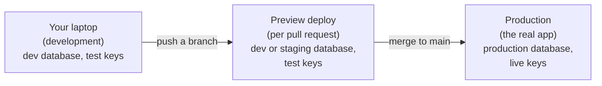

# Starting a project safely: the day-one setup

Most of this guide is about catching problems. This chapter is about not
creating them in the first place. An hour of setup on day one makes many of the
🔴 items automatic, and each one is much harder to add once the app has users
and data.

Labels as elsewhere: 🔴 **Now**, 🟡 **Soon**, ⚪ **Later**.

## Contents

1. [A sensible default stack](#1-a-sensible-default-stack)
2. [Accounts before code](#2-accounts-before-code)
3. [The repository](#3-the-repository)
4. [Two of everything: development and production](#4-two-of-everything-development-and-production)
5. [Safety on from the first table](#5-safety-on-from-the-first-table)
6. [Seeing what happens](#6-seeing-what-happens)
7. [Copy-paste setup prompts](#7-copy-paste-setup-prompts)

---

## 1. A sensible default stack

### Pick one well-known stack, and stay with it — 🟡 Soon

AI tools work best with popular, well-documented tools (see
[Vibe coding well](02-vibe-coding-well.md#1-before-you-prompt)). Here is one
common combination for a web app with logins, data and payments. It's not the
only good choice, but every part of it is widely used, well documented and well
known to AI tools.

| Job | A common default | Watch out for |
|---|---|---|
| App framework | **Next.js** with **TypeScript** | Which code runs on the server and which in the browser (see [Reading your project](01-reading-your-project.md#8-words-for-where-code-runs)) |
| Database, logins, file storage | **Supabase** | Row Level Security policies on every table; the secret key stays on the server; free projects pause after a week of inactivity |
| Hosting | **Vercel** or **Netlify** | Vercel's free Hobby plan is for non-commercial use only |
| Payments | **Stripe** | Test mode first; access granted only by verified webhooks |
| Email | **Resend** or **Postmark** | Set up your domain's email records (SPF, DKIM, DMARC) |
| Error tracking | **Sentry** | Keep personal data out of error reports |
| Styling | **Tailwind CSS** | |
| Input validation | **Zod** | Validate on the server, not just in forms |

Common swaps: Firebase instead of Supabase; Clerk or Auth0 for logins; Render
or Railway for hosting; Python with Django or FastAPI if you prefer Python.
Whatever you pick, write it in your rules file so the AI doesn't switch tools
halfway through.

---

## 2. Accounts before code

### Secure your accounts — 🔴 Now

Before writing any code:

- Use a **password manager**, with a different password for every service.
- Turn on **two-factor login** for GitHub, your host, your database, your
  payment provider, your AI providers, your email provider and your domain
  registrar. Save the recovery codes somewhere safe.
- Create every account **in your name** (or your company's), never a
  freelancer's.
- Register your **domain** with **auto-renew** on.
- Set **billing alerts** the moment you create each paid account, and a hard
  spending limit where one exists (see *Cost Optimization* in
  [the reel, explained](04-the-reel-explained.md#5-operations--resilience)).

---

## 3. The repository

### Set up the repo before the first feature — 🔴 Now

1. Create a **private** GitHub repo.
2. Add a `.gitignore` that lists `.env`, `.env.local` and `node_modules/`
   **before** the first commit. Most project templates include one; check it.
3. Add a `.env.example` listing every setting the app needs, with the values
   left blank.
4. Write a short `SPEC.md` and a rules file (`CLAUDE.md`, `AGENTS.md` or your
   tool's equivalent). See [Vibe coding well](02-vibe-coding-well.md#3-what-your-ai-can-and-cant-see)
   for a starter.
5. Add a `README.md` that says how to run the project.
6. Ask your AI for a GitHub Actions workflow that runs the build, the linter
   and the tests on every pull request (see [Testing](10-testing-for-non-coders.md)).

### Work in branches from the start — 🟡 Soon

Make changes on a branch, open a pull request, check its preview deploy, then
merge. It's a small habit that gives you a review step and an easy undo for
every change. (GitHub's *branch protection*, which enforces this, is free on
public repos and needs a paid plan for private ones; the habit works either
way.)

---

## 4. Two of everything: development and production

### Separate environments — 🔴 Now

**What it is:** Your app runs in more than one place, and each place has its
own database and keys:



*From your laptop, to a preview of each change, to the real app. Only
production touches real users' data and real money.*

**What it means for you:**

- **Two database projects** (for example, two Supabase projects): one for
  development and previews, one for production. Supabase can also run a
  database on your own computer through its command-line tool.
- **Test keys everywhere except production.** Stripe's test mode in
  development and previews; live keys only in production.
- **Settings per environment** on your host. Vercel, for example, lets you set
  different environment variables for Production, Preview and Development.
- **No production credentials on your laptop** or anywhere your AI agent can
  reach them.

---

## 5. Safety on from the first table

### Database defaults — 🔴 Now

From the very first table:

- Row Level Security **on**, with a policy that checks the row belongs to the
  logged-in user (or their organization). Never "allow everyone".
- **Explicit grants** on Supabase: new projects no longer let the API reach new
  tables automatically, so each table needs a `grant` to the `authenticated`
  role (and to `anon` only if logged-out visitors should see it). If you see
  "permission denied for table", the fix is the grant, never turning off Row
  Level Security.
- An owner column (`user_id`, or `org_id` for team apps) on every table of
  private data.
- Money as integer cents, times as `timestamptz` in UTC, and `created_at` and
  `updated_at` columns (see [Your database, explained](07-your-database.md#3-storing-values-the-right-way)).
- Every change made through **migrations** that are saved in Git, never by
  clicking around in the production dashboard.

### Login defaults — 🔴 Now

In your auth provider's settings:

- **Email verification** on.
- **Allowed redirect URLs** set exactly: your production domain, your preview
  pattern and `localhost`, with no wildcards for "any site".
- **Leaked-password protection** and rate limits on, if offered.
- Roles stored where only the server can write (see
  [Logins, done right](08-logins-done-right.md#3-mistakes-around-login)).

### Code defaults — 🔴 Now

Put these in your rules file from day one, so the AI follows them in every
feature:

- Validate every input on the server with Zod.
- Check login **and** ownership in every route and server action.
- Rate-limit login, sign-up and anything that costs money.
- Keep secrets in server code only, and never in variables with public
  prefixes (`NEXT_PUBLIC_`, `VITE_`).

---

## 6. Seeing what happens

### Watch it from the first deploy — 🟡 Soon

It's cheapest to add these before launch, while nothing is on fire:

- **Error tracking** (Sentry or similar), with personal data filtered out.
- An **uptime monitor** on your production address.
- Your host's **logs**, and knowing where to find them.
- **Backups:** check what your database plan includes. Free plans often
  include limited or no backups, so export a copy regularly yourself until
  you upgrade.

---

## 7. Copy-paste setup prompts

### Set up a new project

```
Set up a new project with this stack: [Next.js + TypeScript, Supabase,
Vercel, Stripe, Zod, Tailwind]. Before writing features:
1. A .gitignore that excludes .env, .env.local and node_modules, and a
   .env.example listing every variable with blank values.
2. A README explaining how to run it, and a CLAUDE.md/AGENTS.md with the
   stack, versions and safety rules (validate input on the server with Zod,
   check login and ownership in every route and server action, RLS policies
   on every table, secrets only on the server, money as integer cents, times
   as UTC).
3. Database migrations in the repo, with Row Level Security on, an owner
   policy, and explicit grants to the authenticated role for every table.
4. A GitHub Actions workflow that runs build, lint and tests on every pull
   request.
5. Separate settings for development and production, with Stripe test keys
   in development.
Explain each step in plain words as you go.
```

### Check an existing setup

```
Check this project against a safe day-one setup: .env ignored by Git and a
.env.example present; README and rules file present; CI running build, lint
and tests; separate development and production databases and keys; RLS on
with owner policies for every table; migrations in the repo; server-side
validation; login and ownership checks in every route and server action;
rate limits on auth and paid endpoints; error tracking and backups. For each,
say done, missing, or can't tell, and how to fix what's missing.
```

---

Next: [The reel, explained, term by term](04-the-reel-explained.md)
