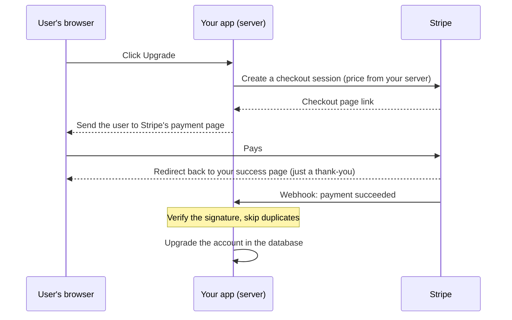

# The reel, explained: every term in plain English

The original post is a handwritten list by @nataindata: *"Who's gonna tell
vibe coders about..."* followed by 111 numbered engineering terms. Reposts and
the video's caption showed parts of it, sorted into groups.

This guide explains all 111 terms. It uses the caption's groups and adds a
ninth group for the terms the caption left out. It also covers Data
Validation, which appears only in the caption, plus one bonus entry.

I put **Security** first, because that's where beginners get hurt most.

If a word in here makes no sense yet, read [Start here](00-start-here.md)
first.

## How to read the labels

- 🔴 **Now**: learn this **before** you put an app online that has logins,
  payments, or other people's data.
- 🟡 **Soon**: learn this once real people use your app, or when you hit the
  problem.
- ⚪ **Later**: big-system or big-company stuff. Know what the word means, then
  skip the details until it's actually your problem. Many professional
  developers rarely touch these.

The 🔴 entries get the longest explanations. The ⚪ entries are kept short on
purpose.

## Contents

1. [Security](#1-security)
2. [Databases & performance](#2-databases--performance)
3. [Core infrastructure & architecture](#3-core-infrastructure--architecture)
4. [Deployments & reliability](#4-deployments--reliability)
5. [Operations & resilience](#5-operations--resilience)
6. [Performance metrics & networking](#6-performance-metrics--networking)
7. [Infrastructure & build tools](#7-infrastructure--build-tools)
8. [Production reality](#8-production-reality)
9. [Inside your running code](#9-inside-your-running-code)

---

## 1. Security

### Bonus, not in the reel: Broken Access Control — 🔴 Now

**What it is:** A logged-in user can see or change data that isn't theirs.
Example: your app loads `/api/orders/123`, someone changes it to
`/api/orders/124`, and they're looking at a stranger's order.

**Picture it:** The hotel checks you have *a* room key, but not that it's the
key for *this* room.

**What it means for you:** This tops the [OWASP Top 10](https://top10.owasp.org/2025/en/),
the industry's standard list of web app risks. In the 2025 edition OWASP
reports that every application it tested had some form of it. AI code often
checks "is someone logged in?" and forgets "is this *their* record?". With
Supabase, the fix is Row Level Security turned on for every table, **with
policies that check the row belongs to the logged-in user** (for example
`auth.uid() = user_id`), never "allow everyone" policies; with Firebase, real
Security Rules (not "test mode"). Test it yourself: log in as
user A and try to read user B's data.

### SQL Injection — 🔴 Now

**What it is:** Your app builds a database command by pasting in text the user
typed. An attacker types database code instead of normal text, and your
database runs it.

**Picture it:** A form says "Name: ____". Someone writes *"Bob. Also, hand
over every customer record."* and the clerk reads the whole line out as an
order.

**What it means for you:** One bad query can leak or delete your whole
database. The fix is **parameterized queries** (or a library like Prisma,
Drizzle or the Supabase client) that keep user text and commands separate. AI
usually gets this right, but check anywhere it glues strings together to build
SQL, like `"SELECT * FROM users WHERE email = '" + email + "'"`.

### XSS (Cross-Site Scripting) — 🔴 Now

**What it is:** An attacker gets their own JavaScript to run inside your
website, in *other users'* browsers. Usually they save it as "text" (a comment,
a username, a bio) that your app later shows as real HTML.

**Picture it:** Someone writes on the restaurant's notice board *"Ignore the
menu, hand your wallet to the man by the door"*, and every customer reads it as
an official notice.

**What it means for you:** The attacker's script runs *as the victim*. It can
see what they see, act as them, and steal login tokens kept in the browser.
React, Vue and Svelte escape text by default, so the danger signs are code that
skips that: `dangerouslySetInnerHTML`, `v-html`, `innerHTML`, or showing
user-written HTML or Markdown without a sanitizer such as DOMPurify.

### SSRF (Server-Side Request Forgery) — 🟡 Soon

**What it is:** Your server fetches a URL a user gave it (link previews,
"import from URL", an AI agent that browses). The attacker gives an *internal*
address instead, and your server, which sits inside the trusted network,
fetches private things for them. A classic target is the cloud's internal
metadata address, which can hand out cloud credentials.

**Picture it:** You let customers say "send the kitchen boy to fetch something
from this address", and someone writes the address of the restaurant's own
safe.

**What it means for you:** Only relevant if your server fetches URLs that
users control. If it does, allow only the domains you expect and block
private/internal addresses.

### CSRF (Cross-Site Request Forgery) — 🟡 Soon

**What it is:** You're logged in to an app, then you visit an evil website.
That site secretly makes your browser send a request to the app ("change my
email", "send money"), and your browser helpfully attaches your login cookie.

**Picture it:** Someone slips a form under your door and your assistant mails
it, because it's on your letterhead.

**What it means for you:** Modern frameworks, and cookies set with
`SameSite=Lax` or `Strict`, block most of this. It matters if you use cookie
logins with hand-built forms or APIs. Never let a plain link (a GET request)
change data.

### CORS (Cross-Origin Resource Sharing) — 🟡 Soon

**What it is:** A browser safety rule. By default, JavaScript on one website
can't read the answers from a *different* website's API. CORS is how your API
tells browsers which other websites are allowed to call it.

**Picture it:** A guest list at your API's door. The browser checks the list
before letting another website's code read the answer.

**What it means for you:** You'll meet it as a red error in the browser
console, "blocked by CORS policy", usually when your frontend and backend live
at different addresses. The right fix is adding *your own* frontend's address
to the allowed list. The tempting fix, which AI often suggests, is allowing
every website: fine for a truly public API, risky for anything with logins.
And CORS is only enforced by browsers. Tools like `curl` ignore it, so it's not
a lock on your API; your server must still check who's asking.

### JWT / OAuth — 🔴 Now (as "don't build login yourself")

**What it is:** **OAuth** is the standard behind "Log in with Google/GitHub":
Google vouches for the user and your app never sees their Google password.
(Strictly, the login part is OpenID Connect, built on OAuth 2.0.) A **JWT**
(JSON Web Token, said "jot") is a signed digital pass the server gives you after
login. Your app shows it with every request to prove who you are.

**Picture it:** OAuth is a bouncer who accepts a passport from a trusted
country instead of checking you himself. A JWT is a festival wristband: signed
so it can't be faked, but whoever holds it gets in until it expires.

**What it means for you:** Use an auth provider (Supabase Auth, Clerk, Auth0,
Firebase Auth, Better Auth) instead of building login and password storage
yourself. Common AI mistakes: reading a JWT without *verifying its signature*,
tokens that never expire, and putting private information inside a JWT. Anyone
can read what's inside one; it's encoded, not encrypted.

### JWT Rotation — 🟡 Soon

**What it is:** Keeping login tokens short-lived and replacing them regularly.
The usual setup is a short-lived *access token* (minutes) plus a longer-lived
*refresh token* that gets you a new one. Each time the refresh token is used,
it's swapped for a fresh one too. The term also covers changing the secret key
that signs the tokens.

**Picture it:** A hotel key card that stops working every day, so the front
desk issues a new one. A lost card is only useful to a thief for a short time.

**What it means for you:** A stolen token that never expires is a permanent
key to someone's account. Good auth providers (Supabase Auth, Clerk, Auth0,
Firebase Auth) handle rotation for you, which is one more reason not to build
login yourself. If your JWT signing secret ever leaks, replace it: every token
signed with it can be forged. Expect that to log everyone out.

### Secrets Management — 🔴 Now

**What it is:** Keeping passwords, API keys and tokens (your OpenAI key, Stripe
secret key, database password) out of your code and out of public view.

**Picture it:** You don't tape the safe's combination to the front window.

**What it means for you:** Bots scan GitHub and public websites for leaked keys
constantly, and a leaked AI or cloud key can be abused within minutes, on your
bill.

- Keep secrets in environment variables: a `.env` file locally, and your host's
  "Environment Variables" settings in production.
- Make sure `.env` is in `.gitignore` **before** your first commit.
- Never put secret keys in frontend code. Watch for name prefixes that ship to
  the browser: `NEXT_PUBLIC_`, `VITE_`, `REACT_APP_`, `EXPO_PUBLIC_`. Anything
  with those is public.
- If a key leaks, **revoke and replace it at the provider immediately**.
  Deleting it from your code isn't enough; it's still in your Git history.

### IAM (Identity and Access Management) — 🟡 Soon

**What it is:** The system that decides who (people, apps, servers) can do what
in your cloud accounts. The core idea is **least privilege**: give each thing
only the permissions it needs.

**Picture it:** The dishwasher gets a key to the kitchen, not to the safe.

**What it means for you:** Prefer limited keys where a service offers them.
Supabase example: the *publishable* key (`sb_publishable_...`, called the
`anon` key in older projects) is meant to be public, but the *secret* key
(`sb_secret_...`, formerly `service_role`) ignores all security rules and must
only live on the server. Turn on
two-factor login (2FA) for GitHub, your host, your cloud and your domain
registrar.

### WAF (Web Application Firewall) — ⚪ Later

A filter in front of your app that blocks requests that look like known attacks
(injection attempts, bad bots). Like a doorman who turns away people carrying
crowbars. **For you:** Cloudflare, Vercel and AWS offer one. It's a nice extra
layer, not a replacement for safe code.

### DDoS Protection — ⚪ Later

DDoS (Distributed Denial of Service) means flooding your app with so much fake
traffic, from so many machines, that real users can't get in. Like a thousand
people who order nothing blocking the restaurant door. **For you:** Big hosts
and Cloudflare absorb most of this. Your realistic risk is smaller: one bot
hammering one expensive endpoint, like your AI chat. See *Rate Limiting* and
*Cost Optimization*.

### TLS/SSL — 🔴 Now (and usually free)

The encryption behind **HTTPS**, the padlock in the browser. It stops people on
the same Wi-Fi or network from reading or changing your traffic. SSL is the old
name, TLS the current one; people use both. Like sending letters in a locked
box instead of on a postcard. **For you:** Vercel, Netlify, Render and
Cloudflare set it up automatically. Just never serve logins or data over plain
`http://`.

### Encryption in Transit — 🔴 Now (and usually free)

Data is encrypted *while it travels* between computers: browser to server,
server to database. TLS is how. **For you:** Use HTTPS, and connect to your
database with SSL turned on (most hosted databases require it already).

### Encryption at Rest — ⚪ Later

Data is encrypted *while it sits on disk*, so a stolen disk or backup file is
unreadable. **For you:** Most managed databases and cloud storage do this by
default; check that it's on. Separately, passwords must be **hashed** (with
bcrypt or argon2), never stored as they are. That's another reason to let an
auth provider handle them.

---

## 2. Databases & performance

### Database Migrations — 🟡 Soon

**What it is:** Step-by-step scripts that change your database's structure
(add a table, add a column, rename something) in a controlled, repeatable way,
while keeping the data already in it.

**Picture it:** Renovating the kitchen while the restaurant stays open, with
written instructions so every branch gets exactly the same renovation.

**What it means for you:** Changing the database by hand, or letting an AI
"just recreate the table", can wipe real user data, and dropping a column
deletes its data for good. Use your tool's migration system (Prisma Migrate,
Drizzle Kit, Supabase migrations, Django or Rails migrations). Read every
migration before it runs on production, look for `DROP`, `DELETE` and
`TRUNCATE`, and back up first.

### Schema Versioning — 🟡 Soon

The **schema** is the shape of your database: its tables, columns and types.
Schema versioning means tracking which version of that shape each database is
on, in Git, so your local, test and production databases don't drift apart.
Migrations are how you move from one version to the next. **For you:** Commit
your migration files. Don't change production by clicking around a dashboard
without capturing the change in a migration.

### N+1 Queries — 🟡 Soon

**What it is:** Your code asks the database once for a list (1 query), then
once more *for each item* in the list (N more queries). 100 blog posts turns
into 101 database trips instead of 1 or 2.

**Picture it:** The waiter walks to the kitchen separately for each guest's
fork instead of bringing all the forks at once.

**What it means for you:** AI-written code does this often: a database call
inside a loop or inside `.map()`. It's fine with 10 rows and painful with
10,000. Ask your AI: *"Is there an N+1 query here? Use a join or one batched
query."*

### Connection Pooling — 🟡 Soon

**What it is:** Opening a database connection is slow, and a database allows
only a limited number at once. A pool keeps a few connections open and lends
them to whichever request needs one.

**Picture it:** A row of shared shopping carts at the entrance, instead of each
shopper building a cart from scratch.

**What it means for you:** The classic error is *"too many connections"* once
traffic grows, especially on serverless hosts, where every copy of your
function opens its own connections. Use your provider's pooled connection
string (Supabase and Neon both offer one).

### Read Replicas — ⚪ Later

Copies of your database that only answer *read* questions, taking load off the
main database (which handles the writes). **For you:** Only when one database
is too busy. Replicas can be a moment behind; see *Eventual Consistency*.

### WebSockets — 🟡 Soon (only if you need live updates)

A connection that stays open so the server and the browser can message each
other at any time, instead of the browser always having to ask first. Like a
phone call that stays connected, instead of letters back and forth. **For
you:** Used for chat, live dashboards, multiplayer and collaborative editing.
Many serverless platforms can't hold these connections open themselves, so
hosted services (Supabase Realtime, Pusher, Ably, Firebase) save you a lot of
work.

### Long Polling — ⚪ Later

The browser asks "anything new?" and the server holds the question open until
there's news (or a time limit), then the browser asks again. An older, simpler
way to fake real-time updates. **For you:** Just know the word.

### Server-Sent Events (SSE) — 🟡 Soon

A one-way open connection where the server keeps sending updates to the
browser. Simpler than WebSockets when only the server needs to talk. **For
you:** This is how most AI chat apps stream an answer word by word. If your AI
answers arrive all at once after a long wait, streaming (often over SSE) is the
fix.

### Database Indexing — 🟡 Soon

**What it is:** An index is a lookup table the database keeps so it can find
rows without reading every single one.

**Picture it:** The index at the back of a book. Without it, you read all 500
pages to find the word "Docker".

**What it means for you:** If a page gets slower as your data grows, a missing
index is the first suspect. Add indexes on columns you often filter or sort by
(`user_id`, `email`, `created_at`). Indexes take space and slow writes a little,
so don't index everything.

### Query Optimization — ⚪ Later

Rewriting database questions so they do less work: fetch only the columns you
need, filter inside the database instead of in your code, use indexes, avoid
N+1. The `EXPLAIN` command shows how the database plans to run a query. **For
you:** When something is slow, ask your AI to run `EXPLAIN` on the slow query
and explain the result.

### CAP Theorem — ⚪ Later

When a database is spread over several machines and the network between them
breaks (a *partition*), it must choose: stay **C**onsistent (refuse to answer
rather than risk giving old data) or stay **A**vailable (answer anyway, maybe
with old data). It can't do both during the break. P stands for Partition
tolerance. Picture two bank branches losing their phone line: either both stop
withdrawals (consistent), or both carry on and might let someone overdraw
(available). **For you:** Theory and job-interview material.

### Eventual Consistency — ⚪ Later

After you change data, not every copy sees the change instantly, but they all
will "eventually", usually within milliseconds to seconds. Like changing your
profile photo while a friend still sees the old one for a few seconds. **For
you:** Explains "I saved it but the page still shows the old value" bugs when
caches or replicas are involved.

### Optimistic Locking — ⚪ Later (🟡 if two people can edit the same thing)

Assume conflicts are rare. Let anyone edit, but when saving, check "has anyone
changed this since I loaded it?" (often with a version number). If yes, reject
the save and ask them to retry. It's Wikipedia's "edit conflict" message.

### Pessimistic Locking — ⚪ Later (🟡 if you sell limited stock)

Assume conflicts will happen. Lock the record while one person works on it, and
everyone else waits. Like the single key to a café's bathroom. **For you:**
Both kinds of locking matter the moment two people can click "Buy" on the last
ticket at the same instant.

### Distributed Locks — ⚪ Later

A lock that works across many servers (often using Redis or the database), so
only one server does a job at a time, such as sending the daily email once
instead of five times.

### Sharding — ⚪ Later

Splitting your data across several separate database servers, each holding a
slice, such as users A–M on one machine and N–Z on another, so no single
machine has to store or serve everything. **For you:** Only at very large
scale. A single Postgres database with good indexes handles millions of rows.

### Partitioning — ⚪ Later

Splitting one big table into smaller pieces, often inside the same database,
for example one piece per month of orders, so a query about this month can skip
the rest. Sharding is partitioning spread across several machines. **For
you:** Later.

### Replication — ⚪ Later

Keeping copies of your data on several machines, for safety and speed. Read
replicas and failover are built on it. **For you:** Your managed database
provider handles it, usually on paid tiers.

### Leader Election — ⚪ Later

When several servers work together, they automatically pick one to be in
charge (the *leader*), and pick a new one if it dies. **For you:** Deep
infrastructure; your database and tools do it internally.

### Data Validation — 🔴 Now

**What it is:** Checking data is what you expect *before* you use or save it:
the email looks like an email, the price isn't negative, the name isn't 50,000
characters, the quantity is actually a number.

**Picture it:** The cashier checks the banknote isn't fake before putting it in
the cash register.

**What it means for you:** Attackers don't have to use your nice form; they can
send anything straight to your API. Checks in the frontend are for
friendliness. Checks on the **server** are for safety, so always validate on
the server. Libraries like Zod (JavaScript/TypeScript) or Pydantic (Python)
make it easy; ask your AI to use one. Database rules (`NOT NULL`, `UNIQUE`) are
a last line of defense.

### Deadlocks — ⚪ Later

Two operations each hold something the other needs, and both wait forever.
Like two cars on a one-lane bridge, each waiting for the other to back up.
**For you:** Databases usually notice and cancel one of them, and you'll see a
"deadlock detected" error. The usual fix is doing operations in a consistent
order and keeping transactions short.

---

## 3. Core infrastructure & architecture

### Rate Limiting — 🔴 Now

**What it is:** A cap on how many requests someone can make in a period of
time: 5 login attempts per minute, 20 AI messages per hour per user, and so on.

**Picture it:** "Limit 2 per customer" on the sale shelf.

**What it means for you:** Without it, a bot can guess passwords non-stop, or
call your AI endpoint thousands of times while you pay the bill. It's one of the
most common sources of expensive surprises for vibe-coded apps. Use your
framework's middleware or a service such as Upstash or Cloudflare, limit per
user *and* per IP address, and put the strictest limits on login, signup,
password reset, and anything that costs you money.

### Caching — 🟡 Soon

**What it is:** Saving the result of slow or expensive work so you can reuse it
next time instead of redoing it.

**Picture it:** The kitchen pre-makes a batch of the most popular dish.

**What it means for you:** It makes apps faster and cheaper: cache AI answers
to identical questions, or a homepage that changes once a day. The dangers are
showing stale data and, much worse, caching one user's private page and serving
it to someone else. See *Cache Invalidation*.

### CDN (Content Delivery Network) — 🟡 Soon

**What it is:** A network of servers around the world that keep copies of your
files (images, JavaScript, CSS, videos) close to your users.

**Picture it:** Instead of shipping every order from one central warehouse,
you keep stock in a local shop in every city.

**What it means for you:** Vercel, Netlify and Cloudflare Pages already put
your site on a CDN. Where it matters is user uploads and big images: keep them
in storage that serves through a CDN (Supabase Storage, Cloudflare R2, Amazon
S3 with CloudFront) rather than from your own server or database, and resize
images before serving them. Serving large files yourself is slow, and the
bandwidth can become your biggest bill.

### Edge Caching — ⚪ Later

Caching responses on those CDN servers ("the edge" means the servers nearest
your users), so many requests never reach your server at all. **For you:**
Great for public pages. Dangerous for private ones: if a logged-in page gets
cached at the edge, the next visitor can be shown someone else's account. Make
sure personal pages are marked as not cacheable (`Cache-Control: private` or
`no-store`).

### Load Balancing — ⚪ Later

Spreading incoming traffic across several copies of your server so none is
overwhelmed, and skipping copies that are down. Like a host at the door seating
guests across several waiters. **For you:** Hosting platforms do this
automatically.

### Vertical Scaling — ⚪ Later

Handling more traffic by making your one server bigger, with more CPU and more
memory ("scaling up"). Like buying a bigger oven. It's simple, but there's a
ceiling and the price climbs fast. **For you:** Often the easiest first fix:
upgrade your plan.

### Horizontal Scaling — ⚪ Later

Handling more traffic by adding more servers and splitting the work between
them with a load balancer ("scaling out"). Like hiring more cooks with more
ovens. There's no real ceiling, but your app must not keep important things in
one server's memory (logins, uploads, counters), because the next request may
land on a different server. **For you:** Serverless platforms do this
automatically, which is exactly why you can't rely on in-memory variables
between requests.

### Autoscaling — ⚪ Later

Adding and removing servers automatically as traffic rises and falls: more on a
busy Friday night, fewer at 4am so you pay less. **For you:** Serverless and
most hosting platforms do it for you. The catch is that autoscaling also scales
your bill, so a traffic spike or a bot can scale you into a big invoice. Set a
maximum.

### Reverse Proxies — ⚪ Later

A server that stands in front of your app, receives every request and passes it
on. Along the way it handles HTTPS, caching, compression and blocking bad
traffic. Nginx, Caddy and Cloudflare are examples. Like a receptionist who
greets every visitor and directs them. **For you:** Your host already does
this. You'll meet Nginx or Caddy if you rent your own server (a VPS).

### API Gateways — ⚪ Later

One front door for many APIs or services at once, handling login checks, rate
limits, routing and logging in one place. **For you:** Big-system stuff. With
one app, your framework's middleware does the same job.

### CI/CD — 🟡 Soon

**What it is:** **CI** (Continuous Integration): every time you push code,
robots automatically run checks and tests. **CD** (Continuous Deployment): if
the checks pass, the new version goes live automatically.

**Picture it:** Every dish passes the head chef's taste test before it leaves
the kitchen, automatically, every time.

**What it means for you:** If Vercel or Netlify is connected to your GitHub,
you already have CD: every push to `main` deploys. What most vibe coders are
missing is CI, even a basic "does it build, do the tests pass?" check before
anything goes live. GitHub Actions is the common free tool.

### Docker — ⚪ Later (🟡 if you rent your own server)

Packs your app plus everything it needs (the right Node or Python version,
libraries, settings) into a **container** that runs the same way on any
computer. Like a shipping container: whatever is inside, every port and ship
knows how to handle the box. **For you:** It solves "it works on my machine".
You don't need it on Vercel or Netlify; you'll meet it on Render, Railway,
Fly.io, a VPS, or when running a database locally.

### Kubernetes — ⚪ Later (possibly never)

Software that runs and manages *many* containers across *many* servers: it
restarts crashed ones, adds copies when traffic rises, and rolls out updates.
Like a port authority directing thousands of shipping containers. **For you:**
Huge overkill for a solo project, and plenty of companies run fine without it.

### Service Discovery — ⚪ Later

When you have many small services that start, stop and move around, they need
a constantly updated phone book to find each other. That's service discovery.
**For you:** Only relevant with many services (*microservices*).

### Circuit Breakers — ⚪ Later

If a service you depend on keeps failing, stop calling it for a while (the
circuit "trips"), show a fallback, and try again later, instead of piling up
more failing requests. Named after the breaker in your home's fuse box. **For
you:** Good idea in spirit: if your AI provider is down, show a friendly "try
again in a minute" instead of hanging forever.

### Timeouts — 🟡 Soon

The longest you'll wait for something (an API call, a database query) before
giving up. Like hanging up after ten rings and trying plan B. **For you:**
Without timeouts, one slow outside service can freeze your whole app. AI APIs
can be slow, so set sensible timeouts and show the user a loading or error
state. Your host also has its own limit; see *Serverless Limits*.

### Retries — 🟡 Soon

Trying a failed request again, because many failures are temporary (a network
blip, a busy server). Two dangers: retrying something that isn't safe to repeat,
like charging a card (see *Idempotency*), and retrying so fast that you make an
overload worse (see *Exponential Backoff*).

### Exponential Backoff — 🟡 Soon

Waiting longer and longer between retries (1s, 2s, 4s, 8s...), usually with a
little randomness (*jitter*) so thousands of users don't all retry at the same
moment. Like not ringing a friend 50 times in a minute when they don't pick up.
**For you:** AI APIs answer `429 Too Many Requests` when you hit their limits,
and the right response is backing off, not hammering. The official OpenAI and
Anthropic SDKs already retry with backoff, so check before adding your own.

### Idempotency — 🟡 Soon (🔴 if you take payments)

**What it is:** An action is *idempotent* if doing it twice has the same effect
as doing it once. "Set the balance to 100" is idempotent; "add 100 to the
balance" is not.

**Picture it:** Pressing the elevator button five times still calls one elevator.
Paying at the checkout five times does not work like that.

**What it means for you:** Networks fail halfway through requests, users
double-click "Pay", and Stripe re-sends webhooks, so your code *will* receive
duplicates. Disable buttons after a click, but also make the server safe: use
idempotency keys (Stripe supports them), and store the IDs of events you've
already processed so you can skip repeats.

### Message Queues — ⚪ Later (🟡 if you have slow background jobs)

A waiting line for jobs. One part of your app drops a job in ("send the welcome
email", "process this video") and a worker picks it up in the background. Like
the ticket rail in a kitchen: waiters pin orders, cooks take them in turn.
**For you:** Useful when work is too slow for a normal web request, like
generating a long AI report. Hosted options include Inngest, Trigger.dev and
Upstash QStash.

### Cron Jobs — 🟡 Soon

**What it is:** Tasks that run automatically on a schedule: every night at
2am, every hour, every Monday. The name comes from `cron`, the old Unix
scheduler. Schedules are written like `0 2 * * *`, which means 2am every day.

**Picture it:** An alarm clock for your code.

**What it means for you:** Used for daily emails, cleaning up old data,
renewing subscriptions and syncing data. Your host usually has a version
(Vercel Cron Jobs, Supabase's `pg_cron`, scheduled GitHub Actions). Watch out
for four things:

- **Time zones:** schedules usually run in UTC, not your local time.
- **Silent stops:** a job that quietly stops running goes unnoticed for weeks,
  so add an alert.
- **Double runs:** a job that runs twice or overlaps with itself should be
  idempotent.
- **Open doors:** a job triggered by a public URL that anyone can call. Protect
  that URL with a secret.

### Backpressure — ⚪ Later

When work arrives faster than you can handle it, backpressure is the system
pushing back: slowing senders down, making them wait, or turning extra work
away, instead of piling up an endless backlog until something runs out of
memory. Like a restaurant that stops seating people when the kitchen is full,
instead of taking orders it can't cook. **For you:** Your small version is rate
limits and limits on queue size.

### Pub/Sub — ⚪ Later

Short for publish/subscribe. A publisher announces "an order was placed" on a
*topic*, and any number of subscribers (email, analytics, the warehouse) each
get a copy. The publisher doesn't need to know who's listening, like a radio
station broadcasting to whoever tunes in.

### Event-Driven Architecture — ⚪ Later

Building a system around *events* ("user signed up", "payment succeeded") that
other parts react to, instead of one part calling all the others directly.
Webhooks are a small everyday example.

### Distributed Transactions — ⚪ Later

A **transaction** is a group of database changes that must all succeed or all
fail together: take money from A *and* give it to B, never just one half. That's
easy inside one database. A *distributed* transaction tries to do it across
several databases or services, which is hard and slow. **For you:** Do use
normal transactions for multi-step changes in your one database (ask your AI
"should this be wrapped in a transaction?"). Leave the distributed kind for
later.

### Saga Pattern — ⚪ Later

The practical alternative to distributed transactions: do the steps one at a
time, and if a later step fails, run "undo" steps for the earlier ones. Booking
a trip: flight booked, hotel fails, so cancel the flight.

### Dead Letter Queues — ⚪ Later

Where jobs or messages go after failing too many times, so they don't block the
queue forever and a human can inspect them. Like the post office's
undeliverable-mail room. Comes with message queues.

---

## 4. Deployments & reliability

### Feature Flags — ⚪ Later

On/off switches for features that you can flip without redeploying. Ship code
switched off, turn it on for yourself, then for 10% of users, then everyone,
and switch it off instantly if it breaks. Tools include PostHog, GrowthBook and
LaunchDarkly, or a simple settings table. **For you:** Handy once you have users
you don't want to break.

### Blue-Green Deployment — ⚪ Later

Run two identical copies of production: *blue* (live) and *green* (the new
version). Test green, switch all traffic over at once, and switch back if
anything is wrong. **For you:** Vercel and Netlify give you something similar:
every deploy is kept, and you can roll back to an earlier one. Find that
rollback button now, before you need it.

### Canary Releases — ⚪ Later

Release a new version to a small slice of users first, watch for errors, then
roll it out to everyone. Named after the canaries miners carried to detect
dangerous gas.

### Rolling Deployments — ⚪ Later

Update servers a few at a time instead of all at once, so the app stays up
during the update. Your host handles it.

### Rollbacks — 🟡 Soon (find the button before you launch)

**What it is:** Going back to the previous working version after a bad
deploy.

**Picture it:** Undo, for your live website.

**What it means for you:** When you've just deployed and everything broke, the
fastest fix is usually to roll back first and look for the bug calmly
afterwards. Vercel and Netlify keep your earlier deploys and let you switch
back in a click, and with Git you can revert the bad commit. The catch: rolling
back code does **not** roll back your database. If that deploy ran a migration
that deleted a column, the data is gone. That's another reason to back up
before migrations.

### Health Checks — 🟡 Soon

A simple URL (like `/health`) that answers "I'm OK", so a monitor or load
balancer can check the app is alive. **For you:** Free uptime monitors such as
UptimeRobot or Better Stack check your site every few minutes and message you
when it's down. Better than hearing it from a user.

### Liveness & Readiness Probes — ⚪ Later

Kubernetes' two kinds of health check. *Liveness*: "is it stuck? Then restart
it." *Readiness*: "has it finished starting up, so it can take traffic yet?"
Kubernetes-specific.

### Monitoring — 🟡 Soon

Watching numbers about your app over time: is it up, how fast is it, how many
errors, how much memory, how much money. Like the dashboard in a car. **For
you:** Start with your host's built-in analytics, an uptime monitor, and error
tracking.

### Metrics — 🟡 Soon

Numbers measured over time: requests per minute, error rate, response time,
signups per day, money spent on AI per day. Logs record single events; metrics
show trends. A car's speedometer and fuel gauge, versus a logbook of the trip.
**For you:** Your host's dashboard already shows the technical basics. Add the
business numbers you care about, like signups, active users and AI cost per
user.

### Logging — 🟡 Soon

**What it is:** Your app writing down what happened ("user 42 logged in",
"payment failed: card declined") so you can look back when something goes
wrong.

**Picture it:** A ship's logbook.

**What it means for you:** Without logs, every bug a user reports is guesswork.
Log errors with enough detail to understand them, but **never** log passwords,
card numbers, API keys or login tokens. Error-tracking tools like Sentry catch
crashes with full details automatically, and they take minutes to set up.

### Distributed Tracing — ⚪ Later

Following one request as it travels through many services, timing every hop, to
see where it got slow or failed. Like parcel tracking. **For you:** Needed once
you have many services. OpenTelemetry is the standard.

### Cache Invalidation — 🟡 Soon (once you add caching)

Deciding when cached data is out of date and must be thrown away. It's famously
one of the "two hard things in computer science". **For you:** The bug looks
like "I updated it but the site still shows the old version", or a user seeing
someone else's data from a shared cache. Whenever data changes, ask: which cache
needs clearing?

### Alerts — 🟡 Soon

Automatic messages (email, SMS, Slack) when something crosses a line: the site
is down, errors are spiking, spending is above $X. **For you:** The most
important alert for a vibe coder is a **billing alert**. Set one on every
service that charges you.

### SLOs — ⚪ Later

A Service Level Objective is a reliability target, such as "99.9% of requests
succeed each month" or "95% of pages load in under a second". Related words:
**SLA**, a promise to customers with penalties, and **SLI**, the actual
measurement.

### SLIs — ⚪ Later

A Service Level Indicator is the real measured number behind an SLO, such as
"the share of requests that succeeded this month" or "how long 95% of page
loads took". The SLI is what you measure, the SLO is your target for it, and
the SLA is the promise you make to customers.

### Error Budgets — ⚪ Later

The amount of failure your SLO allows. 99.9% uptime leaves about 43 minutes of
downtime a month. Budget used up? Slow down risky releases and fix reliability.
Budget left? Ship faster.

### Observability — 🟡 Soon

The umbrella word for how well you can understand what's happening inside your
app from the outside, using **logs**, **metrics** (numbers) and **traces**.
Monitoring tells you *that* something is wrong; observability helps you find
*why*. **For you:** Logs, error tracking and a few basic metrics are enough for
a small app.

---

## 5. Operations & resilience

### Backups — 🔴 Now

**What it is:** Copies of your data kept somewhere safe, so you can restore
after an accidental delete, corruption, a bad migration, or a hack.

**Picture it:** A spare house key kept at a friend's place.

**What it means for you:** "The AI agent deleted my production database" has
happened publicly to people building with AI coding agents.

- Turn on automatic backups. Check your plan: free tiers often include limited
  backups or none.
- A backup you've never restored is a hope, not a backup. Practice a restore
  once.
- Keep at least one copy outside your main provider or account.
- Never give an AI agent direct write access to your production database.

### Disaster Recovery — 🟡 Soon

Your plan for getting back up after something big goes wrong: database deleted,
hosting account hacked or suspended, a provider outage, or you being
unavailable. Professionals use two numbers: **RPO**, how much data you can
afford to lose (the last hour? the last day?), and **RTO**, how long you can be
down. **For you:** Write half a page. Where are the backups? How do I restore?
Where are my secrets stored? Who controls the domain? Could I redeploy from
GitHub onto a fresh account?

### Failover — ⚪ Later

Switching automatically to a standby server or database when the main one
fails, like a hospital's backup generator kicking in. **For you:** Managed
databases offer it on higher tiers, often called "high availability".

### Multi-Region Deployment — ⚪ Later

Running your app in several parts of the world (say the US and Europe) so it's
fast for everyone and survives a whole region going down. **For you:** It's
expensive and complex, especially for the database. What you *should* do now:
pick a region near most of your users, and put your server functions in the
**same region as your database**. A mismatch there is a common hidden cause of
slowness.

### Chaos Engineering — ⚪ Later

Deliberately breaking things in production (killing servers, cutting network
links) to prove the system survives. Netflix's "Chaos Monkey" made it famous.
**For you:** The small version is actually testing a restore, and checking what
your app does when the AI API is down.

### Cost Optimization — 🔴 Now (as "set spending limits")

**What it is:** Not paying more than you need to and, above all, making sure
nothing can hit you with a giant surprise bill.

**What it means for you:**

- Set billing alerts everywhere, and hard spending caps wherever a provider
  offers them: AI API dashboards, cloud providers, hosting. Careful: on Google
  Cloud and AWS a "budget" only emails you; it doesn't stop spending. For AI
  APIs, prepaid credits with auto-recharge turned off work as a hard cap.
- Rate-limit every endpoint that costs money.
- Use cheaper AI models for simple jobs, and cache repeated answers.
- Watch for runaway loops: a bug that calls a paid API or function in an
  endless loop is a classic bill-burner.
- Delete things you aren't using.

### Cold Starts — ⚪ Later

Serverless functions go to sleep when unused, and the first request afterwards
has to wake one up, so it's slower. Free-tier servers that sleep after
inactivity have a much bigger version of this, sometimes many seconds. **For
you:** It explains "the first load is slow, then it's fast". Fixes are smaller
functions, a paid always-on tier, or simply accepting it.

### Serverless Limits — 🟡 Soon

**What it is:** Serverless platforms cap each function: maximum running time,
memory, request and response size, and sometimes no long-lived connections or
work after the response has been sent.

**What it means for you:** The classic case: your AI call or file processing
takes longer than the platform's time limit, so it works on your laptop and
dies with a timeout in production. Look up your platform's limits. For long
work, stream the response or move the job to a background queue.

---

## 6. Performance metrics & networking

### Latency — 🟡 Soon

The delay: the time from asking to getting an answer, usually measured in
milliseconds (ms). How long from ordering until the food arrives. **For you:**
Every round trip adds up: browser to server, server to database, server to AI
API. Keep your server near your database and avoid long chains of one-after-the-
other calls.

### Throughput — ⚪ Later

How much work gets done per unit of time, such as requests per second. How
many meals the kitchen serves per hour. Latency is how fast *one* order is;
throughput is how *many* orders get done.

### P99 Latency — ⚪ Later

Sort all your requests by how long they took. **P99** is the time that 99% of
requests beat, so it describes the slowest 1%. **P50** (the median) is the
typical request. Professionals watch P99 because averages hide pain: an average
of 200ms can hide 1 request in 100 taking 5 seconds, and a page that makes 50
requests has about a 40% chance of hitting at least one of those slow ones.

### Tail Latency — ⚪ Later

The general name for those slowest requests at the "tail" of the chart (P99,
P99.9). At large scale, the tail is what users actually feel.

### Network Partitions — ⚪ Later

When machines that should talk to each other can't, because the network
between them is cut, while each one keeps running fine on its own. Neither side
knows if the other is dead or just unreachable. This is the "P" in the CAP
theorem.

### Clock Skew — ⚪ Later

Different computers' clocks disagree, slightly or by a lot. **For you:** Never
trust the *user's device* clock for anything important (trial expiry, coupon
validity, timestamps); use the server's time. A related habit: store times in
UTC and convert to the user's time zone only for display.

### DNS — 🟡 Soon

**What it is:** The internet's phone book. It turns names (`myapp.com`) into
the number addresses computers use (IP addresses).

**What it means for you:** You'll touch DNS when you connect a custom domain,
by adding `A`, `CNAME` or `TXT` records at your registrar. Changes can take
minutes to hours to spread. DNS also matters for sending email: without the
records called **SPF**, **DKIM** and **DMARC**, your emails land in spam. Put
2FA on your domain registrar account, because whoever controls your DNS
controls where your app's address points.

### TCP vs UDP — ⚪ Later

Two basic ways to send data over the internet.

- **TCP** is reliable: everything arrives, in order, or you're told it failed.
  Most of the web, email and file downloads use it (the newest web version,
  HTTP/3, gets the same reliability on top of UDP). Like a phone call where you say
  "sorry, can you repeat that?"
- **UDP** is fast and fire-and-forget: some pieces may get lost or arrive out of
  order. Video calls, online games and DNS lookups use it. Like shouting across
  a room: quick, and if a word gets missed, you carry on.

**For you:** Know the difference; you'll rarely choose between them yourself.

### HTTP/2 & HTTP/3 — ⚪ Later

Newer versions of HTTP, the language browsers and servers speak. HTTP/2 lets
many requests share one connection at the same time. HTTP/3 runs on a protocol
called QUIC (built on UDP) to be faster on patchy mobile networks. **For you:**
Your host turns these on automatically.

### gRPC — ⚪ Later

A fast way for services to call each other, created by Google, using compact
binary messages and a strict contract. It's common between backend services
and less common for browser-facing APIs, which usually use REST and JSON.

### Webhooks — 🟡 Soon (🔴 if you take payments)

**What it is:** Instead of you constantly asking a service "anything new?", the
service calls a URL on *your* server when something happens: "payment
succeeded", "subscription cancelled", "new commit pushed".

**Picture it:** The buzzer a café gives you that vibrates when your order is
ready, instead of you asking at the counter every minute.

*The success page is only a thank-you. The verified webhook is what unlocks
paid access.*

**What it means for you:**

- **Verify the signature** on every webhook (Stripe and others sign them).
  Otherwise anyone can call your URL and fake a "payment succeeded".
- Expect duplicates and out-of-order delivery, so make handlers idempotent.
- Reply quickly and do slow work in the background.
- Don't rely on the browser coming back after payment. A user who closes the
  tab never returns, so the webhook is the source of truth.

### API Versioning — ⚪ Later (🟡 if you have a mobile app, or others use your API)

Keeping old versions of your API working when you change it, for example
`/api/v1/...` alongside `/api/v2/...`. Phone apps that people haven't updated
still call your old API, and changing it breaks them. **For you:** In a
web-only app where frontend and backend deploy together, this rarely bites.

### Semantic Versioning — 🟡 Soon

A numbering rule for software versions: `MAJOR.MINOR.PATCH`, for example
`4.2.1`.

- **PATCH** (4.2.1 → 4.2.2): bug fixes, should be safe.
- **MINOR** (4.2 → 4.3): new features, should not break anything.
- **MAJOR** (4 → 5): breaking changes; your code may need updating.

**For you:** When your AI writes code for version 4 of a library and you have
version 5 installed, things break in confusing ways, and AI knowledge often lags
a version or two behind. Tell your AI which versions you use. In
`package.json`, `^4.2.1` means "any 4.x.x from 4.2.1 upwards".

---

## 7. Infrastructure & build tools

### Infrastructure as Code — ⚪ Later

Describing your servers, databases and DNS in code files instead of clicking
through dashboards, so the setup is repeatable, reviewable and in Git. **For
you:** The small version is writing your setup steps in a README so you could
rebuild everything from scratch.

### Terraform — ⚪ Later

The most popular Infrastructure-as-Code tool (OpenTofu is its open-source
fork). You describe what you want, and it creates or updates it at AWS,
Cloudflare, and so on.

### Helm Charts — ⚪ Later

Ready-made packages of Kubernetes configuration, like an app store package for
Kubernetes. Only relevant if you use Kubernetes.

### Build Caching — ⚪ Later

Reusing work from earlier builds so each new build only redoes what changed and
finishes faster. Your host does this automatically.

### Dependency Hell — 🟡 Soon

**What it is:** Your project uses packages (libraries), which use other
packages, which need specific versions of yet more packages, and they conflict,
or one update breaks everything.

**What it means for you:**

- Commit your **lockfile** (`package-lock.json`, `pnpm-lock.yaml`,
  `yarn.lock`, `poetry.lock`, `uv.lock`). It pins exact versions so every build
  is the same.
- Update dependencies deliberately, a few at a time, not "update everything"
  the night before launch.
- AI tools sometimes suggest packages that **don't exist**, and attackers
  register those invented names with malware inside (this is called
  "slopsquatting"). Before installing an unfamiliar package, check it's real,
  widely used, and the official one.
- Fewer dependencies means fewer problems. Don't install a package for
  something five lines of code can do.
- Turn on GitHub's Dependabot security alerts.

---

## 8. Production reality

### Production Incidents — 🟡 Soon

Something going wrong in the live app that affects users: the site is down,
data is wrong, payments are failing, data has leaked. **For you:** Have a short
playbook ready. How do I roll back the last deploy? How do I switch off a broken
feature? How do I tell users? For a security incident: replace the leaked keys
first, investigate second.

### On-Call — ⚪ Later (you're already on it)

Being the person who must respond when alerts fire, including at 3am. In
companies, people take turns. As a solo builder you're always on call, which is
exactly why alerts and simple systems matter.

### Postmortems — 🟡 Soon

A short write-up after an incident: what happened, a timeline, the root cause,
and what changes so it doesn't happen again. Good postmortems are *blameless*:
they fix the system, not blame the person. **For you:** Keep an `INCIDENTS.md`
file with five lines per incident. It's how you actually learn everything in
this list.

---

## 9. Inside your running code

These four were on the original list but missing from the caption's groups.
They're about what happens inside your program while it runs.

### Race Conditions — 🟡 Soon

**What it is:** A bug where the result depends on which of two things happens
first. Two requests read the same value at the same moment, both act on it, and
one quietly overwrites the other.

**Picture it:** Two people check a shared calendar, both see 3pm is free, and
both book it.

**What it means for you:** Classic examples are two buyers getting the last
ticket, a double-clicked "Redeem coupon" applying twice, and two likes at the
same instant counting as one. These bugs never show up when you test alone. The
usual fixes:

- Let the database do the math in one step (`UPDATE ... SET likes = likes + 1`)
  instead of read, add 1, save.
- Add unique constraints so a duplicate simply can't be saved.
- Use transactions and locking (see *Optimistic Locking* and *Pessimistic
  Locking*).

### Thread Safety — ⚪ Later

Some programs do several things at the same time inside one process, using
*threads*. Code is thread-safe if it still works when two threads touch the
same data at once; when it isn't, you get a race condition inside your program.
**For you:** Node.js runs your JavaScript on a single thread, so you'll mostly
meet thread safety in Python, Java, Go or Rust. The vibe-coder version is shared
global variables on the server: data stored in a global variable can leak from
one user's request into another's.

### Memory Leaks — ⚪ Later

Your program keeps taking memory and never gives it back, usually by adding
things to a list or cache that never gets emptied, or by adding event listeners
and timers that are never removed. Memory use creeps up until the app slows
down or crashes, restarts, and the cycle repeats. Like a desk where papers pile
up and never get filed. **For you:** If your server's memory graph climbs
steadily and it crashes every few days, suspect a leak. In frontends, timers
and listeners that a React `useEffect` never cleans up are a common cause.

### Garbage Collection — ⚪ Later

The automatic cleanup in languages like JavaScript, Python, Java and Go: the
language finds memory that nothing uses anymore and frees it, like a cleaner who
throws away papers nobody will ever read again. A memory leak is when your code
still (accidentally) holds on to something, so the cleaner isn't allowed to
throw it away. Garbage collection can also cause tiny pauses. **For you:** Just
know the word.

---

Next: [What you actually need, and in what order](05-what-you-actually-need.md)
