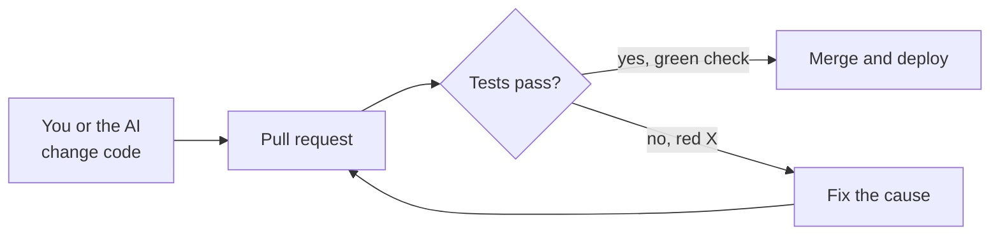

# Testing, for people who don't code

You can't read every line your AI writes, but you can make it prove its work.
Tests are how. They're small programs that check your app does what it should,
automatically, every time anything changes. For a vibe coder they do two jobs:
they catch the AI breaking last week's feature while building this week's, and
they give the AI precise feedback so it can fix its own mistakes before you
ever see them.

Labels as elsewhere: 🔴 **Now**, 🟡 **Soon**, ⚪ **Later**.

## Contents

1. [What a test is](#1-what-a-test-is)
2. [Kinds of tests](#2-kinds-of-tests)
3. [What to test first](#3-what-to-test-first)
4. [Reading test results](#4-reading-test-results)
5. [Tests on every change (CI)](#5-tests-on-every-change-ci)
6. [When the AI writes the tests: the traps](#6-when-the-ai-writes-the-tests-the-traps)
7. [Test data and test environments](#7-test-data-and-test-environments)
8. [Copy-paste testing prompts](#8-copy-paste-testing-prompts)

---

## 1. What a test is

### A robot running your checklist — 🔴 Now

**What it is:** A test runs a piece of your app with a known input and checks
the result. For example:

```ts
test("adds 20% tax to a price in cents", () => {
  expect(addTax(1000)).toBe(1200)
})
```

In plain words: "when `addTax` gets 1000, the answer must be 1200". If someone
(or some AI) later changes `addTax` and breaks it, this test fails and says so.

**Picture it:** The checklist a pilot runs before every flight, done by a robot
in seconds, every single time.

**What it means for you:** You don't need to write tests. You need to ask for
them, run them, and know whether they're any good (section 6).

---

## 2. Kinds of tests

### The main kinds — 🟡 Soon

| Kind | What it checks | Speed | Typical tools |
|---|---|---|---|
| **Unit test** | One small piece on its own, like a price calculation | Very fast; you can have hundreds | Vitest, Jest, pytest |
| **Integration test** | Several pieces together, like an API route with a real test database | Slower | The same tools, plus a test database |
| **End-to-end (E2E) test** | A robot opens a real browser and clicks through your app like a user | Slowest, but closest to reality | Playwright, Cypress |
| **Manual test** | You clicking through it | Slow, and easy to forget a step | You |

Two more checks catch mistakes for free: **type checking** (TypeScript) and a
**linter** (ESLint). Run them alongside the tests.

**What it means for you:** Start with a few end-to-end tests of your most
important flows, plus unit tests for anything involving money, dates or
permissions. That covers most of the risk for the least effort.

---

## 3. What to test first

### The tests worth having — 🔴 Now

In this order:

1. **The money paths, end to end:** sign up, log in, the core feature, and
   payment (in test mode).
2. **Access control:** log in as user A and try to read or change user B's
   data, through the API and not just the screen. The test must show it's
   **blocked**. This one test guards against the #1 web risk (see *Broken
   Access Control* in [the reel, explained](04-the-reel-explained.md#1-security)).
3. **Money and dates:** totals, discounts, taxes, refunds, time zones, trial
   expiry.
4. **Every bug you fix:** add a test that fails without the fix and passes with
   it (a *regression test*), so it can't come back silently.
5. **Input edge cases:** empty, very long, negative, duplicate, or the wrong
   type.

Don't spend tests on exact colors, layout details or text that changes every
week. Those tests break constantly and catch little.

---

## 4. Reading test results

### Pass, fail, and what failed — 🟡 Soon

You run tests with a command your AI sets up, usually `npm test` for unit tests
and something like `npx playwright test` for end-to-end tests. A failure looks
like this:

```
FAIL  src/lib/price.test.ts > adds 20% tax to a price in cents
AssertionError: expected 1199 to be 1200
```

Read it as: **which test** failed (`adds 20% tax...` in `price.test.ts`), what
it **expected** (1200), and what it **got** (1199). That's exactly what to paste
to your AI, along with what you changed recently.

For end-to-end tests, Playwright can show a report with screenshots and a
step-by-step recording of the failing run (`npx playwright show-report`). It's
often the fastest way to *see* what went wrong.

---

## 5. Tests on every change (CI)

### Run them automatically — 🟡 Soon

Tests only help if they run. Have GitHub Actions run the build, the linter and
the tests on every pull request (see [Starting a project safely](03-starting-a-project-safely.md#3-the-repository)):



*Every change goes through the same checks before it reaches users.*

**The rule:** a red X means "don't merge". Fix the cause, never the test.

---

## 6. When the AI writes the tests: the traps

### Tests that can't fail — 🔴 Now

**What it is:** AI-written tests sometimes pass no matter what the app does.
For example, they check something trivially true, mock (fake) the very thing
they're meant to test, or just record whatever the code currently returns, bugs
included.

**What it means for you:** A test is only worth something if it **fails when
the feature breaks.** Check it directly: ask the AI to break the feature on
purpose (change a price, remove a permission check), run the tests, show you the
failure, then undo the break. If nothing fails, the test is decoration.

### "Fixing" the test instead of the bug — 🔴 Now

**What it is:** When a test fails, the quickest way to green is to change the
test's expected answer, mark it as skipped (`.skip`, `xit`), or delete it. AI
tools do this surprisingly often when asked to "make the tests pass".

**What it means for you:**

- Ask for "fix the code so the existing tests pass, and don't change the tests
  without asking me".
- Look at the diff (see [Reading your project](01-reading-your-project.md#4-reading-a-diff)):
  changed or deleted test files deserve a question every time.
- Watch for `.skip`, `.only` (which silently skips every *other* test) and
  commented-out tests.

### Flaky tests — 🟡 Soon

**What it is:** A test that sometimes passes and sometimes fails with no code
change. Common causes are timing (the test checks before the page has loaded),
tests that depend on each other's order, real network calls, and real dates
("today").

**What it means for you:** Don't just re-run until green or switch it off; a
flaky test hides real failures. Ask the AI to find the cause, for example by
waiting for the actual element instead of a fixed number of seconds, using fixed
dates, and faking outside services.

---

## 7. Test data and test environments

### Never test against production — 🔴 Now

Tests create, change and delete data. Run them against a **test database**,
filled by a seed script with realistic fake data, and with **test keys** for
outside services. Stripe's test mode, for example, has test card numbers such as
`4242 4242 4242 4242` that simulate payments without moving money. A test run
pointed at production can delete real users' data, or charge real cards.

### Testing AI features — 🟡 Soon

AI output changes from run to run, so it needs a different kind of test: an
*eval set* of realistic inputs, each with what a good answer must do. See
*Testing AI features (evals)* in [Building AI features](09-building-ai-features.md#10-testing-ai-features-evals).

---

## 8. Copy-paste testing prompts

### Set up testing

```
Set up testing for this project: Vitest for unit tests and Playwright for
end-to-end tests, a separate test database with a seed script of realistic
fake data, test keys for outside services, and npm scripts to run each.
Add a GitHub Actions workflow that runs build, lint and all tests on every
pull request. Explain how I run them and read the results.
```

### Tests that matter

```
Write tests for the paths this app can't afford to break: sign up, log in,
password reset, the core feature, and payment in Stripe test mode (end to
end). Also write an access-control test: as user A, try to read and change
user B's data through the API, and assert it's blocked. Then prove each test
works: break the feature on purpose, show me the test failing, and undo the
break.
```

### Review the tests

```
Review this project's tests. Which ones would still pass if the feature they
cover were broken? Look for tests that mock the thing they test, check
trivially true things, or snapshot whatever the code returns. List any
skipped, .only or commented-out tests. Then tell me what important behavior
has no test at all.
```

### Fix a failing test the right way

```
This test is failing: [paste the output]. Find out whether the code or the
test is wrong, and explain why. Fix the code if the code is wrong. Don't
change, skip or delete the test unless you show me why the test itself is
wrong and I agree.
```

---

Next: [Debugging with AI: how to get unstuck](11-debugging-with-ai.md)
