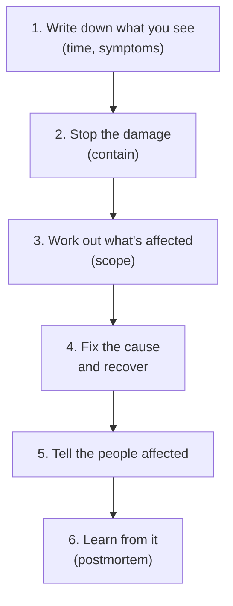

# When things go wrong: an incident playbook

The rest of this guide is about preventing disasters. This chapter is for when
one is already happening: a key has leaked, the bill is exploding, the site is
down, data is gone, or someone got into something they shouldn't have.

In an incident, the natural reaction is to panic and start changing things.
That's how a bad day becomes a terrible one. Most of the damage in small-app
incidents comes from the first hour: the hole stays open while you debug, or
a hasty "fix" deletes the evidence or the remaining data. This chapter gives
you an order to do things in.

Labels as elsewhere: 🔴 **Now** (prepare before anything happens), 🟡 **Soon**.

## Contents

1. [The first hour, for any incident](#1-the-first-hour-for-any-incident)
2. [Playbooks for common incidents](#2-playbooks-for-common-incidents)
3. [Telling users](#3-telling-users)
4. [Afterwards](#4-afterwards)
5. [Prepare now, while nothing is on fire](#5-prepare-now-while-nothing-is-on-fire)
6. [Copy-paste incident prompts](#6-copy-paste-incident-prompts)

---

## 1. The first hour, for any incident

### The order of work — 🔴 Now



*Stop the damage before you investigate, and investigate before you change
more things.*

1. **Write down what you see,** with times: when you noticed, what's broken,
   what you've done. Keep adding to it. You'll need it for users, for support
   tickets and, if personal data is involved, possibly for regulators.
2. **Stop the damage first.** Revoke the leaked key, switch off the broken
   feature, roll back the bad deploy, take the leaking route offline. A
   temporarily broken feature is better than an ongoing leak.
3. **Work out what's affected:** which data, which users, since when. Export
   or screenshot the logs right away: on free and starter plans they often
   disappear within hours or a day.
4. **Fix the cause and recover,** carefully, one step at a time.
5. **Tell the people affected** (section 3).
6. **Learn from it** (section 4).

### Make your AI read-only first — 🔴 Now

During an incident, ask your AI to **investigate without changing anything**:
read logs, read code, explain. Only after you understand the problem, approve
specific fixes one at a time. An agent improvising with production access
during an incident is how "the site is down" becomes "the data is gone".

---

## 2. Playbooks for common incidents

### A secret key leaked — 🔴 Now

It was in a commit, in frontend code, in a screenshot, or pasted in a chat.

1. **Revoke or replace the key at the provider now,** before anything else.
   Removing it from the code does nothing for copies already taken.
2. Put the new key in your host's environment variables and redeploy.
3. Check the provider's **usage and billing pages** for activity you don't
   recognize, and set a spending limit if there isn't one.
4. Think about what the key could reach. A database secret key (like
   Supabase's secret key) can read and change all your data, so treat that leak
   as a possible data breach (below).
5. Remove the key from the code. Rewriting Git history to remove it is
   optional; **replacing the key is what actually protects you.**

### The bill is exploding — 🔴 Now

1. **Stop the spending:** switch off the feature or endpoint, revoke the API
   key, or lower your provider's limits.
2. Find the cause: a bot hammering an unprotected endpoint, a leaked key, or a
   bug looping (see *The bill that grew overnight* in
   [How vibe-coded apps break](12-how-vibe-coded-apps-break.md#money)).
3. Add the missing protection (rate limits, quotas, spending caps) before you
   switch things back on.
4. Contact the provider's support with your timeline. Providers sometimes
   reduce charges caused by abuse or bugs, especially if you act quickly.
   There's no guarantee, but it costs nothing to ask.

### Someone saw data they shouldn't have — 🔴 Now

A user can see other users' data, a table was open to the public, or a key
with database access leaked.

1. **Close the hole:** fix the Row Level Security policy, take the route
   offline, or replace the key.
2. **Save the evidence now.** Don't delete logs or accounts, and export or
   screenshot the logs immediately: on free and starter plans they often
   disappear within hours or a day.
3. **Work out the scope:** which data (emails, names, addresses, payment
   details, messages), how many people, and over what time period. Logs can
   show which pages and tables were requested and from where, but often not
   exactly which records. If you can't rule something out, assume it was seen.
4. **End sessions and replace keys** that may be affected.
5. **Check your legal duties now, not next week.** Under the EU's GDPR, for
   example, a breach that's a risk to people's rights must usually be reported
   to the data protection authority within **72 hours** of you becoming aware
   of it, and people at high risk must be told directly. Other places have
   their own rules. If personal data was exposed, this is the moment to get
   proper legal advice.
6. **Tell the affected users** what happened and what they should do (section
   3).

### The site is down — 🟡 Soon

Check, in this order:

1. **Did you just deploy?** Roll back to the last working version first,
   investigate second (see *Rollbacks* in [the reel, explained](04-the-reel-explained.md#4-deployments--reliability)).
2. **Is a provider down?** Check the status pages of your host, database, auth
   and AI providers.
3. **Did you hit a limit?** Free-tier quotas, a paused free database project, a
   spending cap that switched something off.
4. **Is it the domain?** An expired domain, changed DNS records, or an expired
   certificate.
5. **What do the logs say?** See [Debugging with AI](11-debugging-with-ai.md#3-where-errors-hide).

Post a short status note where your users will see it, even if it's just "we
know, we're on it".

### Data was deleted or damaged — 🔴 Now

1. **Stop further changes:** put the app in maintenance mode or switch off the
   feature that's writing bad data. Every new write makes recovery harder.
2. **Don't let the AI run more "fix" commands** against production. Work out
   what happened first.
3. **Restore your backup into a new, separate database first,** never straight
   over production. Compare it with what's left, then copy back only what's
   missing. If your plan has *point-in-time recovery*, you can restore to the
   minute before the damage, but choose the option that restores into a
   **new** project (Supabase calls it "restore to a new project"). Restoring in
   place overwrites production and loses everything written since that
   moment.
4. Tell the users whose data was affected.

### One of your own accounts was taken over — 🔴 Now

Your GitHub, hosting, database, domain or email account.

1. Recover it through the provider's account recovery. This is where saved
   recovery codes matter.
2. Change the password, turn on (or reset) two-factor login, and sign out all
   other sessions.
3. **Check what the attacker could have changed:** new admins or team members,
   API keys, deploy keys, SSH keys, connected apps (OAuth apps), webhooks, DNS
   records, payout details, and **recent commits and deploys**, which might
   carry malicious code.
4. Replace every secret that account could see.

### Someone reports a security hole — 🟡 Soon

Thank them, confirm the problem, fix it, tell them when it's fixed, and credit
them if they'd like. If the report shows data was exposed, follow *Someone saw
data they shouldn't have*. (See *A way to report security problems* in
[Beyond the reel](06-beyond-the-reel.md#4-security-the-reel-skipped).)

### A wave of spam or bot sign-ups — 🟡 Soon

Turn on a CAPTCHA, tighten rate limits, require email verification, and pause
sign-ups for a while if you have to. Then clean up the fake accounts and
content, and check whether the bots were really after something else, such as
free AI credits or sending emails through your app.

---

## 3. Telling users

### Say what happened, plainly — 🟡 Soon

Tell people quickly and honestly. A good notice says:

1. **What happened,** in plain words, and when.
2. **What data** of theirs was involved, or that their data wasn't involved.
3. **What you've done** about it.
4. **What they should do,** if anything: reset their password, watch for
   phishing emails, check their payments.
5. **How to reach you** with questions.

Don't guess, don't minimize, and don't promise it can never happen again. "We
made a mistake, here's exactly what happened and what we changed" builds more
trust than silence.

---

## 4. Afterwards

### A blameless postmortem — 🟡 Soon

Within a few days, write a short postmortem (see *Postmortems* in
[the reel, explained](04-the-reel-explained.md#8-production-reality)): a timeline,
the root cause, why it wasn't caught earlier, and what changes so it can't
happen again. Then actually make those changes: a test, a rate limit, a rule in
your rules file, a checklist item. An incident you learn from is the most
effective lesson in this whole guide.

---

## 5. Prepare now, while nothing is on fire

### An incident kit — 🔴 Now

Ten minutes now saves hours of panic later. Create `INCIDENT-PLAYBOOK.md` in
your repo (no secrets in it) with:

- **Every service** the app uses, with links to its dashboard, its status page
  and its support contact.
- **Where to replace each key,** and where the app's copy of it lives (which
  environment variables).
- **How to roll back** a deploy.
- **How to switch off a feature** or put the app in maintenance mode.
- **How to restore a backup** into a new database. Practice it once.
- **Who to call** for help: a developer you trust and, if you hold personal
  data, where you'd get legal advice.
- **Where you'd post a status note** to users.

---

## 6. Copy-paste incident prompts

### Investigate without changing anything

```
We have an incident: [what you see]. Investigate it in read-only mode: do
NOT change code, run migrations, delete anything or deploy. Read the logs
and code and tell me: the most likely cause, what data and users may be
affected and since when, and the safest first step to stop the damage. List
any commands you'd want to run and wait for my approval.
```

### A key leaked

```
This key leaked: [name of the key, NOT the key itself]. Find every place the
code and configuration use it, list the environment variables I need to
update after I replace it at the provider, and tell me what this key could
access, so I know whether to treat this as a data breach.
```

### Draft a notice to users

```
Help me write a short, honest notice to affected users about this incident:
[what happened, when, what data, what we did]. Plain language, no jargon, no
minimizing, no promises we can't keep. Include what users should do and how
to contact us.
```

### Write the incident kit

```
Read this project and draft INCIDENT-PLAYBOOK.md: every outside service it
uses (with where its dashboard, status page and key settings are), which
environment variables hold which keys, how to roll back a deploy on our host,
how to switch off each paid feature, and how to restore a database backup
into a new database. No secret values in the file.
```

---

Next: [Rescuing a messy AI-built project](14-rescuing-a-messy-project.md)
